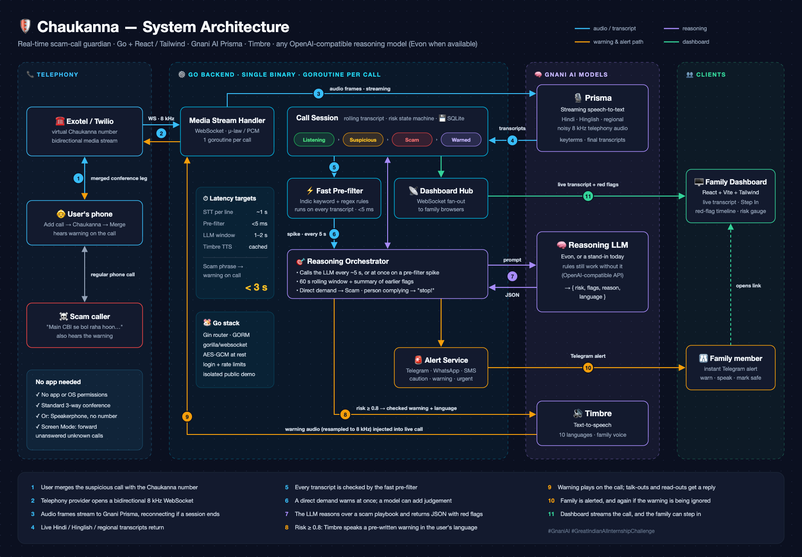
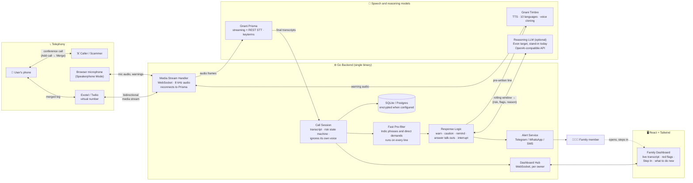
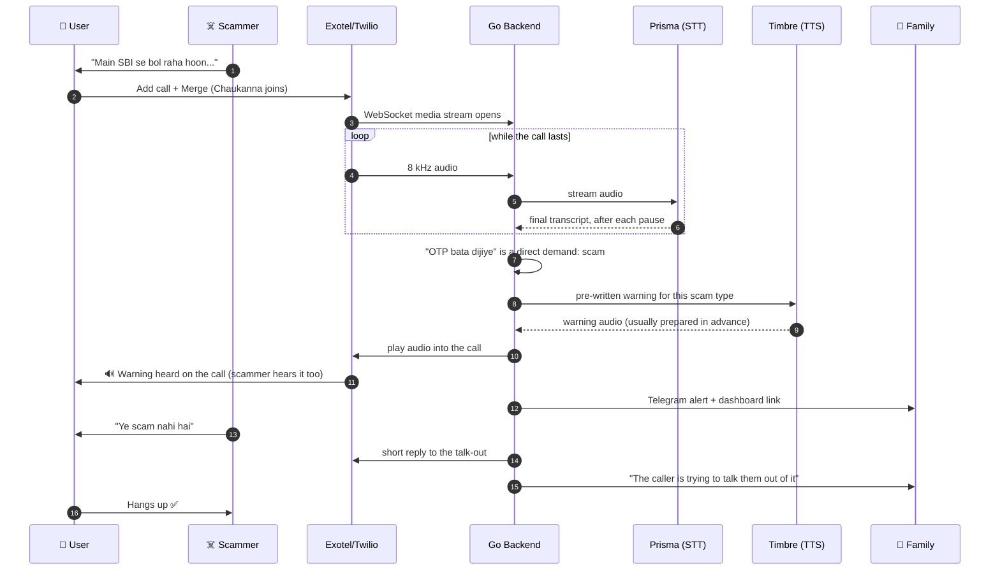
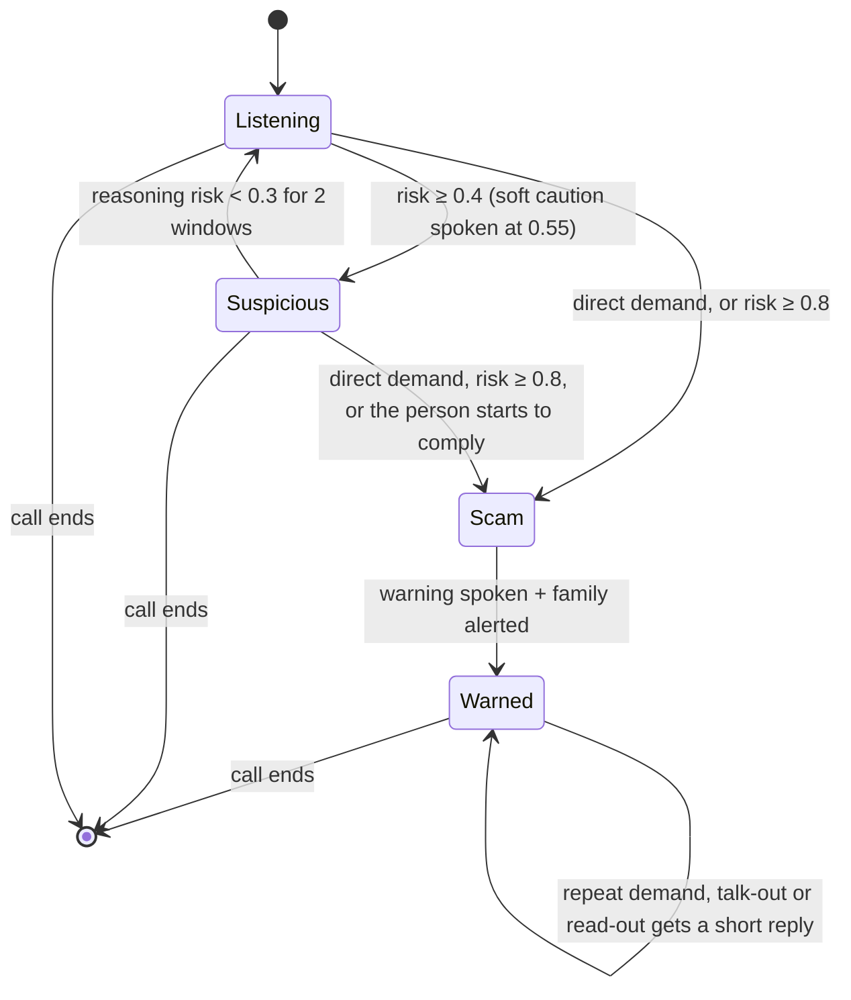
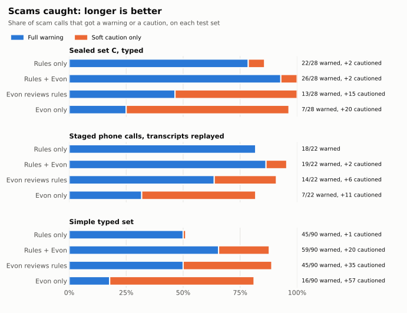
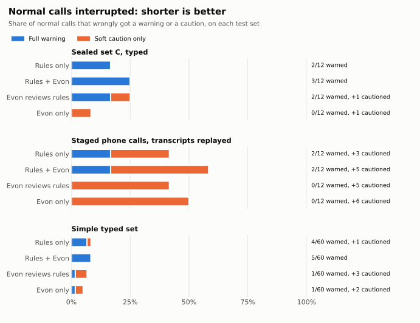

<div align="center">

# 🛡️ Chaukanna

**An AI guardian that joins your parents' phone calls and stops scams while they're happening, in their own language.**

Built with **Gnani AI**: Prisma (speech-to-text) · Timbre (text-to-speech and voice cloning)

Reasoning uses any OpenAI-compatible model. Evon is the target and is not yet on Gnani's API, so measured results name the model actually used.

`#GnaniAI` `#GreatIndianAIInternshipChallenge`

[One-page pitch](PITCH.md) · [User manual](docs/USER_MANUAL.md)

**New here? The [User manual](docs/USER_MANUAL.md) sets it up from scratch and gives a 10-minute guided tour, with no API keys needed.**

</div>

---

## The problem

"Digital arrest" calls, fake courier and customs threats, KYC-expiry calls, and "your son is in police custody" calls are now among the most common frauds in India. They follow a **predictable script**:

1. **Authority.** The caller claims to be CBI, police, customs, TRAI, a courier company or a bank.
2. **Fear.** "There is an arrest warrant", "drugs were found in your parcel".
3. **Isolation.** "Stay on the video call", "don't tell your family".
4. **Urgency.** "Do it in the next 30 minutes or we come to your house".
5. **Extraction.** OTP, AnyDesk/screen share, or a transfer to a "verification account".

The people targeted are often elderly, alone on the call, and speaking Hindi, a regional language or Hinglish over a noisy phone line. Their family usually finds out **after** the money is gone.

## The solution

Chaukanna listens to the call **with** the user. It recognises the scam script as it unfolds, explains each red flag it finds, and steps in before money moves.

| Mode | How it works |
|---|---|
| **Guardian Mode** | During a suspicious call, the user taps **Add call → Chaukanna number → Merge**. It needs no app or permissions, and it has worked on a real call through Exotel. The bot joins silently, analyses the call live, and if a scam is detected it **speaks a warning into the call** in the user's language. It also alerts the family. |
| **Screen Mode** | Unanswered unknown calls are forwarded to Chaukanna. The AI answers in the caller's language, asks who they are and why they're calling, then gives the family a summary and a scam score on the dashboard, and alerts them if it's a scam. On Twilio it also calls the user back with a spoken summary; Exotel doesn't. Not yet tested on a real forwarded call. |
| **Speakerphone Mode** | No phone number needed: put the call on speaker next to a laptop or second phone. The dashboard listens through the microphone and plays the warning through its speakers. |
| **Scam-number memory** | A number caught scamming is remembered. If it calls any protected user again, Chaukanna blocks it in screening or warns immediately in live protection. The family can also report or unblock numbers. |
| **Family Dashboard** | A live web view of each protected call: the transcript, a **red-flag timeline**, the risk score and the reasoning. |
| **Step in** | During a live call the family can press **Warn now**, or type words that are spoken into the call. Scammers depend on the victim being alone. |
| **Family voice** | The warning can play in a family member's cloned voice, recorded with their consent. It still says it comes from Chaukanna AI. |
| **What to do now** | After a scam: steps to take, 1930 and official links, and a **complaint draft** to check and file. Chaukanna files nothing by itself. |
| **Check a call** | Paste the words or upload a recording for a second opinion. Nothing is saved. |
| **Scam Drill** | A practice call: Timbre plays the scammer, the person answers out loud, Prisma listens, and each answer gets feedback. |
| **Alerts** | Telegram (free, private per-person link), WhatsApp, SMS. |
| **Your language** | The screens used during and after a call are in 10 Indian languages, chosen on first launch. Translations aren't yet reviewed by native speakers. |
| **Phone app** | Installs from the browser, with bottom navigation, shortcuts, and an offline screen that gives advice and a 1930 button. |
| **Public demo** | Anyone can try it from a link, without an account. See [Hosting](#hosting-and-the-public-demo). |

### Three ways in

A normal call connects two people, so bringing Chaukanna in takes a step from someone. Each mode asks for something different:

| Mode | What the person has to do | Best for |
|---|---|---|
| **Screen Mode** | Nothing during the call, once unanswered calls are forwarded to Chaukanna | Unknown callers they don't pick up |
| **Guardian Mode** | Three taps during the call | They answered, then got suspicious |
| **Speakerphone Mode** | Put the call on speaker next to a second device | At home, with a spare phone or laptop |

Three taps are hard to remember when frightened, so save the number as a favourite contact and rehearse it with family.

### Graded response

| Risk | What happens |
|---|---|
| Below 0.55 | Nothing is said. |
| 0.55 to 0.79 | A soft caution, telling them how to check for themselves. The family is not alerted. |
| 0.8 and above, or any direct demand | The full warning for that scam type, the family alert and, in Speakerphone mode, a full-screen red alert. |

If the person then seems to be **handing over a code or money** on a doubtful call (reading out digits, "payment kar dungi"), Chaukanna interrupts with a short "stop", and the family gets an urgent alert to call. A refusal ("OTP nahi dungi") doesn't trigger it, and neither does the same phrase on an ordinary call.

**After a warning,** Chaukanna keeps going: a repeated demand gets a short "stop", and a caller trying to discredit the warning ("ye scam nahi hai") gets a reply, up to twice per call. The family is alerted if that happens, or if the person is still on the call 45 seconds later. The family can mark a call safe, which stops the warnings on that call.

A **direct demand** ("tell me the OTP", "install AnyDesk", "scan this QR") is enough by itself, and no model score can overrule it.

Warnings are **pre-written, never model output**, because a frightened person may act on every word. All 10 languages have a warning and a caution. Non-Hindi and non-English lines still need a native speaker's review.

> *"चौकन्ना AI की चेतावनी। यह कॉल धोखाधड़ी लग रही है। डिजिटल अरेस्ट नाम की कोई चीज़ नहीं होती। पुलिस वीडियो कॉल पर गिरफ़्तार नहीं करती। कुछ मत बताइए, फ़ोन काट दीजिए, और 1930 पर कॉल कीजिए।"*
> ("A warning from Chaukanna AI. This call looks like a fraud. Digital arrest does not exist. Police never arrest anyone over a video call. Share nothing, hang up, and call 1930.")
> (spoken by Timbre, into the live call)

---

## How Gnani AI powers Chaukanna

Every word Chaukanna hears and says on a call goes through Gnani's speech models. Without them it can't listen to a call or warn anyone.

| Gnani API | What it does here | Used in |
|---|---|---|
| **Prisma v3 streaming STT** | Transcribes the live call, in real time, on 8 kHz phone audio. Hindi, Hinglish and regional languages, with English words kept in Latin script | Speakerphone, Twilio and Exotel calls |
| **Prisma keyterms** | Boosts words that matter on scam calls (OTP, AnyDesk, CBI, KYC, UPI), so they survive a bad line | Every live call |
| **Prisma REST STT** | Transcribes uploaded recordings and spoken drill answers | Check a Call, Scam Drill |
| **Timbre TTS** | Speaks every warning into the call, in 10 Indian languages | Warnings, cautions, screening calls, Scam Drill's caller |
| **Voice cloning** | Speaks warnings in a family member's voice, with their consent | Family voice |
| **Evon** | Reasoning. Benchmarked self-hosted; not on Gnani's API yet and not yet tried on a live call. Results from another model are labelled with that model | Reasoning layer |

**What the integration adds, beyond calling the APIs**

- **Built around Prisma's real behaviour:** it reconnects past the 15-minute session limit, waits for the last words on closing, and adds up an OTP that Prisma splits across lines.
- **Built around Timbre's real behaviour:** the helpline is written out so Timbre says "one nine three zero", which `cmd/warningcheck` found by speaking each warning and transcribing it back through Prisma.
- **Built around the API limits:** a queue puts live warnings ahead of background clips, because a key allows one REST request at a time per service.
- **Measured:** `cmd/noisebench` runs calls through Timbre, an 8 kHz phone line, street noise and Prisma. See [results](benchmark/results.md).

---

## Architecture



<details>
<summary>Mermaid version (editable)</summary>



</details>

### What happens during one call



### Risk state machine



**Design decisions**

- **Rules first, reasoning optional.** A pre-filter that costs almost nothing runs on every line, and direct demands trigger straight away. A reasoning model adds judgement if one is configured, and a slow or failed request never blocks a warning.
- **Warnings are never model output.** The model decides whether to warn and explains why on the dashboard. The spoken words are pre-written.
- **The call isn't over when the warning plays.** Scammers answer warnings, so Chaukanna keeps listening for repeat demands, talk-outs and a person starting to comply.
- **A person beats a machine.** A warning from a machine can be argued with, so the family hears when one is being ignored, and can step into the call.
- **Asymmetric thresholds.** A false alarm on a genuine bank call costs trust, and a miss costs someone's savings. A direct demand is a scam by itself. Softer flags only add up, and a family can mark a false alarm safe.
- **Privacy first.** No call audio is stored. See [Privacy and safety](#privacy-and-safety).

### Latency budget (targets)

These are design targets, not measurements.

| Stage | Target |
|---|---|
| Speech ends → Prisma's final transcript | about 1 s, including its 0.5 s pause detection |
| Pre-filter | < 5 ms (measured at about 0.4 ms per line) |
| Reasoning model, if configured | 1–2 s, never holding up a warning |
| Timbre warning synthesis | **~0 ms** once clips are prepared at startup. Before that, it waits ~1-2 s for Timbre |
| **Scam phrase spoken → warning on the call** | **< 3 s** |

---

## Tech stack

| Layer | Technology |
|---|---|
| Backend | **Go 1.26**, **Gin** (HTTP), **GORM** (ORM), `gorilla/websocket`, `godotenv` |
| Database | SQLite by default (pure Go, zero setup) · Postgres via `DATABASE_URL` |
| Frontend | **React 18 + Vite + TypeScript**, **Tailwind CSS v4**, React Router |
| Telephony | Exotel Voicebot (tested on real calls) **or** Twilio Media Streams (bidirectional WebSocket) |
| Speech-to-text | **Gnani Prisma v3** (streaming and REST, with keyterms) |
| Text-to-speech | **Gnani Timbre**, plus Gnani voice cloning for the family voice |
| Reasoning (optional) | Any OpenAI-compatible model. **Evon** is the target, and it can be self-hosted |
| Alerts | Telegram, plus WhatsApp Cloud API, then Twilio SMS, then logs |
| Hosting | One Docker container for the backend and dashboard |

---

## Repository structure

```
chaukanna/
├── backend/                          # Go (Gin + GORM)
│   ├── .env                          # all keys and settings (git-ignored), copy from .env.example
│   ├── cmd/
│   │   ├── server/                   # wires everything together and starts Gin
│   │   ├── benchmark/                # recall, false alarms, time-to-detect, per scam type
│   │   ├── noisebench/               # calls through Timbre, a phone line, noise and Prisma
│   │   ├── exportcalls/              # turns labelled calls into benchmark files
│   │   ├── warningcheck/             # speaks each warning and transcribes it back
│   │   ├── gnanicheck/               # checks your Gnani key end to end
│   │   └── smoketest/                # tests every feature against a running server
│   └── internal/
│       ├── scam/                     # flag types, scam types, warnings in 10 languages  ← start here
│       ├── prefilter/                # phrase matching, demands, talk-outs, read-outs
│       ├── detector/                 # risk state machine + safety rules (pure logic, unit-tested)
│       ├── session/                  # live call engine: guardian.go, screen.go
│       ├── stt/                      # Prisma streaming (reconnects) and REST
│       ├── tts/                      # Timbre and voice cloning
│       ├── gnanihttp/                # queue + retries for Gnani's one-request limit
│       ├── reasoner/                 # reasoning client + prompts/guardian.md, prompts/screen.md
│       ├── telephony/                # Twilio, Exotel and Speakerphone WebSocket handlers
│       ├── alerts/ telegram/ twilio/ # family alerts
│       ├── report/                   # after-call steps and complaint draft
│       ├── drill/                    # Scam Drill scripts and answer judging
│       ├── evaluate/ cases/ noise/   # shared benchmark logic
│       ├── api/                      # routes, access rules (access.go), handlers, simulator
│       ├── ratelimit/ hub/ clips/    # limits, live dashboard events, temporary audio
│       ├── models/ database/ config/ # tables and encryption, migrations, settings
│       └── audio/                    # μ-law, PCM, WAV, resampling
├── web/src/
│   ├── lib/                          # api.ts, access.tsx (login, demo), live.tsx, speakerphone.ts, wavRecorder.ts
│   ├── components/                   # ElderAlert, FamilyControls, WhatNextCard, TestLabelCard, GnaniKeyCard, ...
│   └── pages/                        # Calls, CallDetail, Speakerphone, Check, Drill, Simulator, People, Login
├── benchmark/
│   ├── cases/                        # tuning scenarios, also used by the simulator
│   ├── dev/                          # calls used to tune the rules
│   ├── holdout/                      # calls never tuned on (set C)
│   ├── staged/                       # transcripts of staged phone calls
│   ├── simple/, simple-calls.csv     # 150 simple typed calls
│   ├── results/                      # saved scores: rules/, evon/, gpt-oss/, noise/
│   ├── charts/                       # the charts in this README
│   ├── scripts/                      # draw the charts, convert the CSV
│   └── results.md                    # the numbers, with their caveats
├── docs/                             # user manual, deployment, architecture, competitive analysis, test-call scripts
├── deploy/evon/                      # running Evon on your own GPU
└── Dockerfile                        # one container: backend + dashboard
```

---

## Getting started

For a step-by-step version with a guided tour and what you should see at each step, see the [User manual](docs/USER_MANUAL.md).

### Prerequisites

- Go 1.26 and Node 20+
- **Nothing else is needed to try the simulator.** Every integration is optional and switches on when its keys are set.
- For real calls: a Gnani API key, and for a phone number, an Exotel or Twilio account and `ngrok`.

### 1. Run it (no keys needed)

```bash
# terminal 1: backend on :8080
cd backend
cp .env.example .env
go run ./cmd/server

# terminal 2: dashboard on :5173
cd web
npm install
npm run dev
```

Open http://localhost:5173, go to **Simulator** and run a scenario. Without a reasoning model, detection uses the rules. Without Timbre, warnings appear as text only.

### 2. Add your Gnani key

In `backend/.env`, set `GNANI_API_KEY`. This turns on Prisma, Timbre and voice cloning. Check it with:

```bash
cd backend && go run ./cmd/gnanicheck
```

`http://localhost:8080/health` lists which integrations are configured.

### 3. Family alerts on Telegram (free)

1. Create a bot with @BotFather, put its token in `TELEGRAM_BOT_TOKEN`, and restart the backend.
2. On the **People** page, press **Set up** next to the person, and copy the private link.
3. Open it on the family member's phone and tap **Start**.

### 4. Speakerphone mode (no phone number needed)

Open http://localhost:5173/speakerphone, press **Start listening** and allow the microphone. Put the call on speaker next to the laptop. The warning plays through the speakers, and the microphone pauses while it plays.

- **Browser on a second phone:** the microphone needs https, so run `ngrok http 5173` and open that address. Set `DASHBOARD_PASSWORD` first: through a tunnel, the dashboard asks for it.
- **Browser on the same phone as the call:** this usually can't work, because the call takes the microphone. The page warns you if the microphone hears nothing.

### 5. Connect a real phone number (optional)

```bash
ngrok http 8080        # put the https URL in PUBLIC_URL in backend/.env
```

**Exotel** (tested on real calls):

1. Set `EXOTEL_STREAM_TOKEN` in `backend/.env` to a long random value (`openssl rand -hex 24`), and restart the backend.
2. In App Bazaar, create a flow: **Call Start → Voicebot → Hangup**. Set the Voicebot URL to `wss://<your-ngrok-address>/ws/exotel/<that value>`.
3. In **ExoPhones**, edit your number and choose the flow under **App**.

Trial accounts last 7 days, and may need numbers whitelisted under **Settings → Whitelist Numbers**.

**Twilio** (stream handling tested only with simulated streams): set your number's *A call comes in* webhook to `POST https://<your-ngrok-address>/telephony/twilio/voice`. Trial accounts can't send custom SMS.

How a call is routed:
- **The protected user calls the number** (Add call → Merge during a suspicious call): **Guardian Mode**.
- **Anyone else calls it** (unknown calls forwarded on no-answer): **Screen Mode**.

### 6. Try it live

1. Call a friend from the protected phone. The friend plays the scammer, using `docs/test-call-scripts.csv` or their own words.
2. Tap **Add call**, dial the Chaukanna number, tap **Merge**.
3. Watch the dashboard, and listen for the warning on the call.

### 7. Add a reasoning model (optional)

Set `LLM_PLUS_RULES=true` for rules plus a model, or `false` for rules only. With `true`, the rules' warnings stand and the model can add more. If no model is configured or a request fails, the rules carry on alone.

Set `EVON_BASE_URL`, `EVON_MODEL` and `EVON_API_KEY` to any OpenAI-compatible endpoint. Evon isn't on Gnani's API yet, so the options are another hosted model as a stand-in, or running Evon yourself on a GPU: see [`deploy/evon/README.md`](deploy/evon/README.md). Always report which model a result came from.

### Testing everything

Start a server with `TELEPHONY_TEST_MODE=true`, on a laptop only, then:

```bash
cd backend && go run ./cmd/smoketest            # add -skip-streams to save Gnani credits
```

---

## API

| Method | Path | Purpose |
|---|---|---|
| GET | `/health` | status and configured integrations |
| POST | `/telephony/twilio/voice` | Twilio webhook (returns TwiML) |
| GET | `/ws/twilio`, `/ws/exotel/:token` | call audio streams |
| GET | `/ws/dashboard`, `/ws/speaker` | live events, and Speakerphone audio |
| GET/POST | `/api/me`, `/api/login`, `/api/logout` | who is asking, family login |
| GET | `/api/stats` | headline numbers |
| GET | `/api/calls`, `/api/calls/:id`, `/api/calls/active` | call history and details |
| GET/POST/DELETE | `/api/users` | protected people |
| GET/POST/DELETE | `/api/scam-numbers` | known scam numbers: list, report, unblock |
| GET | `/api/scenarios` | simulator scenarios |
| POST | `/api/simulate` | replay a scenario `{scenario_id, mode, speed}` |
| POST | `/api/calls/:id/warn`, `/api/calls/:id/speak` | family steps into a live call |
| POST | `/api/calls/:id/safe` | family: this call is fine, stop warning |
| POST | `/api/calls/:id/label` | test label for scoring |
| POST | `/api/calls/:id/outcome` | family verdict: `confirmed_scam`, `false_alarm`, `money_lost` |
| GET | `/api/calls/:id/report` | what to do next, complaint draft |
| POST | `/api/analyze` | check pasted text or an uploaded recording |
| POST/DELETE | `/api/users/:id/voice` | enrol or delete a family voice |
| POST | `/api/users/:id/consent` | record consent |
| GET | `/api/users/:id/telegram-link` | private Telegram link |
| GET/POST | `/api/drill/scenarios`, `/api/drill/turn` | Scam Drill |

With nothing set, the API is open only to requests from the same computer, for local use. `DASHBOARD_PASSWORD` adds a login page (`POST /api/login`, `/api/logout`, `GET /api/me`). `DASHBOARD_TOKEN` lets scripts use `Authorization: Bearer <token>`. Visitors in demo mode may send `X-Gnani-Key` to use their own Gnani key.

---

## Reasoning output contract

Any reasoning model, Evon or otherwise, returns this:

```json
{
  "risk": 0.91,
  "stage": "isolation",
  "language": "hi",
  "flags": [
    { "type": "authority_impersonation", "t": 14.2, "quote": "main CBI headquarters se bol raha hoon" },
    { "type": "fear_threat",             "t": 31.0, "quote": "aapke naam pe arrest warrant hai" },
    { "type": "isolation",               "t": 48.5, "quote": "video call band mat karna, kisi ko mat batana" }
  ],
  "reason": "Caller impersonates CBI, threatens arrest, and demands the victim stay isolated on video. Matches the digital-arrest pattern.",
  "warning_text": "Saavdhaan. Yeh call fraud lag rahi hai. Police kabhi video call par arrest nahi karti. Phone kaat dijiye."
}
```

`warning_text` is ignored: spoken warnings are always the pre-written lines.

**Flag taxonomy:** `link_or_qr` · `authority_impersonation` · `fear_threat` · `urgency` · `isolation` · `secrecy` · `otp_request` · `remote_access_app` · `money_transfer` · `personal_data_request` · `too_good_to_be_true`

---

## Benchmark

The benchmark replays every scenario in `benchmark/cases/` through the **same detector the server uses** (pre-filter, then the reasoning model if configured, then the state machine), on a simulated clock.

```bash
cd backend
go run ./cmd/benchmark                                  # text scripts (uses the reasoning model if configured)
EVON_BASE_URL= EVON_MODEL= go run ./cmd/benchmark       # rules only
go run ./cmd/benchmark -audio                           # use recordings through Prisma when a case has "audio"
go run ./cmd/benchmark -out ../benchmark/results/results.json   # save details
```

To add a scenario, drop a JSON file in `benchmark/cases/`:

```json
{
  "title": "Fake customs officer",
  "label": "scam",
  "language": "hi",
  "audio": "recordings/customs-01.wav",
  "lines": [ { "t": 1, "text": "Main customs office se bol raha hoon" } ]
}
```

**Rules only, on 40 calls the rules were never tuned on** ([full results and caveats](benchmark/results.md)):

| | Old rules | New rules (typed) | New rules (audio, 5 dB street noise) |
|---|---|---|---|
| Scams caught | 5/28 (18%) | **22/28 (79%)** | **23/28 (82%)** |
| False alarms | 1/12 | **2/12** | **2/12** |

The sample is small, and the audio is Timbre voices rather than real callers. The LLM layer is not included in these figures. Tuned sets score 100%, which is why that isn't the number to quote.

### Evon, measured

**Evon v3.3 30B (full precision) on our own A100 GPU**, on three test sets. [Full results and caveats](benchmark/results.md).





| | Rules only | **Rules + Evon** | Evon reviews rules | Evon only |
|---|---|---|---|---|
| **Set C, sealed:** scams warned | 22/28 | **26/28 (93%)** | 13/28 | 7/28 |
| False alarms | 2/12 | 3/12 | 2/12 | 0/12 |
| **Staged calls:** scams warned | 18/22 | **19/22 (86%)** | 14/22 | 7/22 |
| False alarms | 2/12 | 2/12 | 0/12 | 0/12 |
| **Simple set:** scams warned | 45/90 | **59/90 (66%)** | 45/90 | 16/90 |
| False alarms | 4/60 | 5/60 | 1/60 | 1/60 |

- **Rules + Evon:** the rules' warnings stand, and Evon can add more. This caught the most scams on every set, with up to one more false alarm than rules alone. **Live calls use this logic when `LLM_PLUS_RULES=true`.**
- **Evon reviews rules:** Evon decides on rule hits, while direct demands and codes being read out act at once. It raised fewer or equal false warnings, but also gave fewer or equal full warnings. Benchmark only.
- **Evon only:** no rules at all. It raised the fewest false warnings, or tied for fewest, and reached a warning or caution on 81-96% of scams, but its scores rarely reach the 80% needed for a full warning. Benchmark only.

**Which model runs live:** `LLM_PLUS_RULES` picks rules only or rules + LLM, and `EVON_*` picks the model. Evon isn't on Gnani's API yet and hasn't run on a live call. These numbers apply only with Evon behind that setting; they don't apply to another model, such as gpt-oss-120b.

Set C was written before these setups existed and none were tuned on it, but it has now been re-run. Staged calls are 34 real speakerphone calls (22 scam, 12 normal), replayed from their transcripts rather than run live with Evon, and three of the scams were used to fix the rules. The simple set is 150 short typed calls (90 scam, 60 normal) from `benchmark/simple-calls.csv`, written by the same assistant as the rules, so it shows what plain phrasing exposes, not real-world accuracy. Evon's speed isn't quoted, because another project shared the GPU during these runs.

```bash
python3 benchmark/scripts/csv-to-cases.py
cd backend
EVON_BASE_URL= EVON_MODEL= BENCHMARK_DIR=../benchmark/simple go run ./cmd/benchmark -totals-only -out ../benchmark/results/rules/simple-rules.json
python3 ../benchmark/scripts/make-charts.py   # redraw the charts from the saved results
```

### Testing with real friends' calls

1. **Set up:** keep the phone call on speaker next to a laptop, and open http://localhost:5173/speakerphone on the laptop.
   - **Browser on a second phone:** the microphone needs https, so run `ngrok http 5173` and open that https address. Set `DASHBOARD_PASSWORD` first: through a tunnel, the dashboard asks for it.
   - **Browser on the same phone as the call:** this usually can't work, because the call takes the microphone. The page warns you if the microphone hears nothing.
2. **Label each call:** after the call, open it and use **Test label**. Choose Scam and its type, or Normal call. Label what your friend intended, not what Chaukanna decided. The Calls page shows your count.
3. **Export and score once, after all the calls:**

```bash
cd backend
go run ./cmd/exportcalls -labelled -out ../benchmark/fresh   # add -from N -to M to pick a range of call numbers
EVON_BASE_URL= EVON_MODEL= BENCHMARK_DIR=../benchmark/fresh go run ./cmd/benchmark -totals-only -out ../benchmark/results/rules/fresh-rules.json
```

Doing fewer than 60 calls? The `priority` column in `docs/test-call-scripts.csv` marks 30 core calls and 10 extra. Regional-language calls need a test person set to that language in **People**, or Prisma listens for the wrong language.

**Score scripted calls and own-words calls separately**, using `-from` and `-to` with your call numbers. The scripts in `docs/test-call-scripts.csv` were written by the same assistant as the rules, so only own-words calls are a fair number to quote.

`-totals-only` hides the per-call lines, so you aren't tempted to tune on them. The report shows a 95% range and a table per scam type. With about 30 calls the range is wide, so quote it alongside the score.

### Held-out calls (generalisation)

`benchmark/cases/` and `benchmark/dev/` were used to tune the rules, so scores on them are optimistic. `benchmark/holdout/` holds calls nothing is tuned on, and measures how Chaukanna handles situations it has never seen (see [its README](benchmark/holdout/README.md)):

```bash
cd backend
go run ./cmd/exportcalls -scam 14,15 -legit 16                     # copy recorded calls into holdout/
BENCHMARK_DIR=../benchmark/holdout go run ./cmd/benchmark
```

### Noisy-call benchmark

`cmd/noisebench` builds realistic noisy calls from the same scenarios:

1. **Timbre** speaks each line, using a male "caller" voice where available.
2. **Noise** is mixed in at a chosen signal-to-noise ratio. The options are synthetic **street** noise (traffic rumble, engine hum, horns), crowd **babble** (several other voices), **white** noise, or **your own recording**.
3. The audio is reduced to **8 kHz μ-law**, the same quality a phone line delivers.
4. It is streamed to **Prisma** in real time.
5. The same detector as the live server judges the call.

The report shows, for each noise level: scams caught, false alarms, time-to-detect, and how close the transcript stays to the clean one.

```bash
cd backend
go run ./cmd/noisebench                                   # street noise: clean, 10, 5, 0 dB
go run ./cmd/noisebench -noise babble -snr clean,5,0      # crowd noise
go run ./cmd/noisebench -noise ~/Downloads/market.wav     # a real recording from your phone
go run ./cmd/noisebench -only scam-01,legit-02 -save-audio ../benchmark/noisy   # listen to what Prisma heard
```

The report is written to `benchmark/results/noise/noise-results.md`. Timbre clips are cached in `benchmark/.tts-cache/`, so re-runs only spend Prisma credits.

Prisma v3 also gets a list of **scam keywords** (OTP, AnyDesk, CBI, KYC, UPI, bank names…) through its `keyterms` setting, so those words are recognised reliably on noisy lines.

Scam scripts are written from **public** advisories and news reports (I4C / cybercrime.gov.in, RBI, and bank awareness campaigns). No real victims' audio is used.

---

## Hosting and the public demo

**Deploying for reviewers or judges?** Follow [docs/DEPLOY.md](docs/DEPLOY.md): a one-click Render blueprint (`render.yaml`), a checklist, and a message to send the panel. On a first visit, the app opens its own **Guide** with a 10-minute tour.

The Dockerfile builds one container with the backend and the dashboard. The microphone needs https, so host it somewhere that provides it. Set `DASHBOARD_URL` to the public address, or the links in alerts won't open on phones.

| Setting | Use |
|---|---|
| `DASHBOARD_PASSWORD` | Login page for the family's data. Required on a hosted copy: without it, the dashboard opens only on localhost. Don't use `VITE_DASHBOARD_TOKEN` instead, because it gets built into the page where anyone can read it |
| `ENCRYPTION_KEY` | Encrypts what was said on calls, voice models and chat ids. If you lose it, those rows can't be read |
| `DEMO_MODE=true` | Turns on the public demo below |
| `TRUSTED_PROXIES` | Your host's proxy addresses, so rate limits see real visitors |
| `GNANI_API_KEY` | In demo mode, used at startup to prepare warning clips. Leave it empty to spend nothing; warnings then show as text |
| `DEMO_SHARED_KEY=true` | Lets visitors use the microphone, recordings and spoken drill answers on your key, up to `DEMO_SHARED_DAILY_LIMIT` (200) listening sessions a day. Off by default |

**In demo mode, a visitor:**

| Can | Can't |
|---|---|
| Run the Simulator, Check a Call with pasted text, and Scam Drill with typed answers, with no key | See anyone else's calls, or any real person, number or transcript |
| Use the microphone, upload recordings and speak in drills with **their own Gnani key** | Trigger a real alert (the call page shows what would have been sent) |
| See their own calls for an hour, then they're deleted | Spend the server's Gnani credits or LLM budget, unless `DEMO_SHARED_KEY=true` |

The visitor's key stays in their browser tab, goes to this server only to reach Gnani, and isn't stored or logged. The family logs in with the password, and sees only real calls.

**Limits:** per-visitor limits on checks, drills, simulations and microphone sessions, plus a cap per address, 2 demo calls at once per visitor and 20 overall. Login attempts are limited too.

---

## Privacy and safety

- Consent is recorded per person, and again for any cloned voice, which must be the speaker's own. The voice can be deleted at any time, and the reference recording is not kept.
- Every spoken warning says it comes from Chaukanna AI.
- No call audio is stored. Check a Call and Scam Drill save nothing.
- `STORE_TRANSCRIPTS` controls which transcripts are kept (`flagged` by default). `RETENTION_DAYS` deletes transcripts and quotes after 30 days by default.
- Twilio webhooks and media streams are verified, so calls can't be faked. Exotel doesn't sign its streams, so its URL must carry a secret (`EXOTEL_STREAM_TOKEN`), and Exotel stays off without one.
- With `ENCRYPTION_KEY` set, transcripts, quotes, alert text, call summaries, voice models and Telegram chat ids are encrypted with AES-256-GCM. Rows from before the key was set stay readable until they're deleted by retention. Phone numbers aren't encrypted, because calls are looked up by them.
- A false alarm marked by the family releases the number.
- Audio and transcripts do go to the configured speech and reasoning providers to do the job.
- All demo calls are staged re-enactments and are labelled as such.

**Security**

- Without `DASHBOARD_PASSWORD`, the dashboard opens only for requests made on the same computer. Through ngrok, Docker or a hosted address it asks for a login.
- POSTs, DELETEs and WebSockets from another website are refused, and session cookies are `HttpOnly` and `SameSite=Strict`.
- The dashboard can't be framed by another site, and secrets in URLs (the Exotel token, `?token=`) are hidden in request logs.
- Telegram links work once, so a forwarded link can't move a family's alerts to another chat.
- Ids in URLs are checked to be numbers before any database lookup, and WebSocket messages and uploads have size limits.
- `govulncheck` and `npm audit` report no known vulnerabilities in the dependencies.

---

## Roadmap

- [ ] Bank / UPI integration: pause outgoing transfers while a call is flagged
- [ ] Android companion app with one-tap "Protect this call"
- [ ] Native-speaker review of the regional warnings, and scam-specific warnings beyond Hindi and English
- [ ] Automatic checks of call recordings
- [ ] A shared database of scam phone numbers, built from detected calls
- [ ] Contact-centre version for banks: flag fraud on inbound customer calls
- [ ] Separate logins per family member
- [ ] Legal review (call recording rules, DPDP Act, 2023) before real-world use

---

## Status

| | |
|---|---|
| Speakerphone on real calls, real Telegram alerts | ✅ Tested |
| Real phone calls through Exotel, warning played on the call | ✅ Tested on a few staged calls |
| Add call → Merge on a real call | ✅ Tested through Exotel on a staged call |
| Demo mode, own-key use, login, rate limits, encryption | ✅ Tested locally, not hosted yet |
| Prisma reconnecting after its 15-minute session limit | 🟡 Tested against a fake server, not on a real 15-minute call |
| Interrupting a read-out, reminders, talk-out replies, follow-up alerts, Safe button | 🟡 Tested with replayed text, not yet on a real call |
| Twilio stream handling | 🟡 Tested with simulated streams |
| Evon on the current rules | 🟡 Benchmarked on replayed and typed calls on our own GPU, not yet tried on a live call |
| Docker image | 🟡 Built and run locally with dummy settings, not hosted or tried with real speech keys |
| Phone app: install, offline screen, bottom navigation | 🟡 Checked in desktop Chrome at phone size, not yet on a real phone or a hosted address |
| Interface in 10 languages | 🟡 Machine-translated, not reviewed by native speakers. Setup and test screens are in English |

### Lighthouse

Lighthouse 12.8 on the production build served by the Go backend (`WEB_DIST`), on 8 November 2026. Measured on localhost, so a hosted copy will be slower on network time.

| Page | Performance (mobile / desktop) | Accessibility | Best practices | SEO |
|---|---|---|---|---|
| Calls (home) | 100 / 100 | 100 | 100 | 100 |
| Speakerphone | 100 / 100 | 100 | 100 | 100 |
| Check a call | 100 / 100 | 100 | 100 | 100 |
| Scam Drill | 100 / 100 | 100 | 100 | 100 |
| Simulator | 100 / 100 | 100 | 100 | 100 |
| People | 100 / 100 | 100 | 100 | 100 |
| One call's page | 99 / 98 | 100 | 100 | 63 |

A call's page scores 63 for SEO on purpose: `robots.txt` keeps search engines away from `/calls/`, because those pages hold private transcripts.

---

## Team

| Member | Contribution |
|---|---|
| _Name_ | Go backend, telephony streaming, Prisma/Timbre integration |
| _Name_ | Evon prompt and serving, benchmark, React dashboard |

---

<div align="center">

**Built for the Gnani AI Great Indian AI Internship Challenge**

Prisma 🎙️ · Timbre 🔊

</div>
