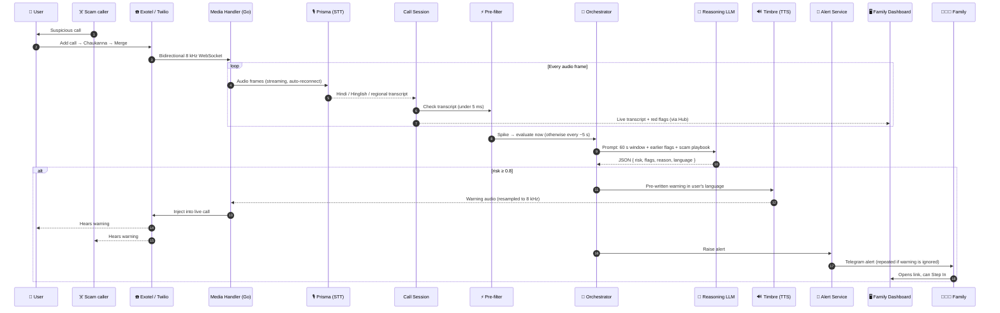
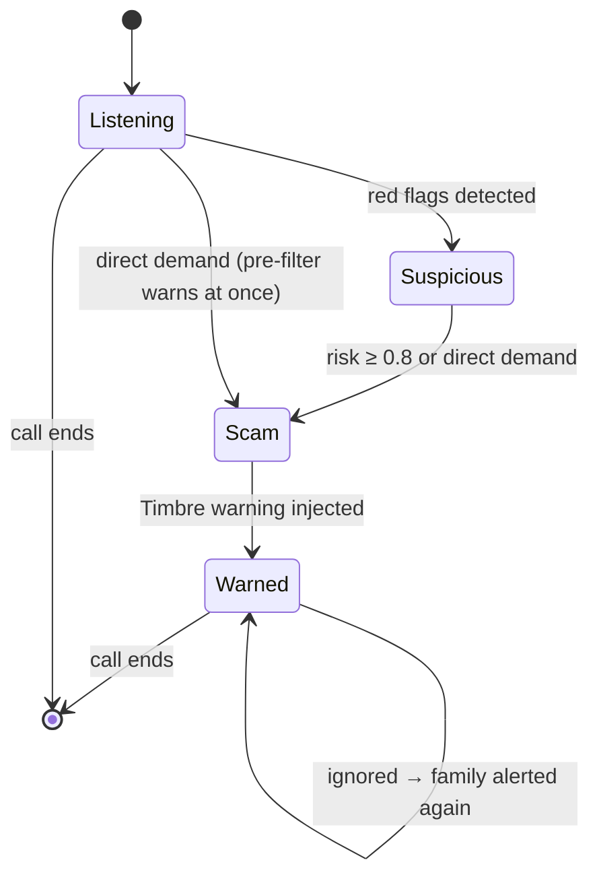
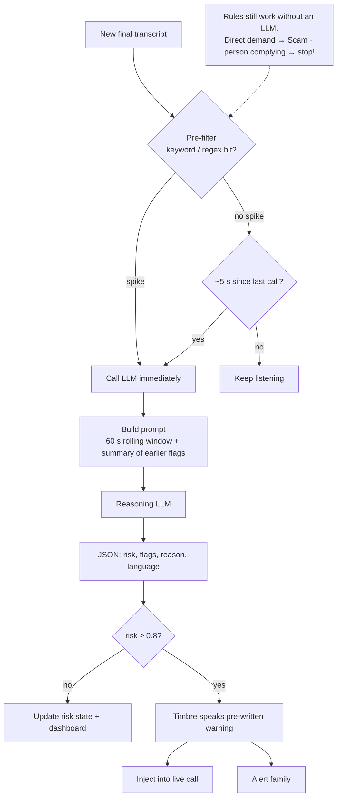

# 🛡️ Chaukanna — System Architecture

Real-time scam-call guardian · Go + React / Tailwind · Gnani AI Prisma · Timbre · any OpenAI-compatible reasoning model (Evon when available)

`#GnaniAI #GreatIndianAIInternshipChallenge`

---

## 1. System overview

```mermaid
flowchart LR
    subgraph TEL["📞 TELEPHONY"]
        direction TB
        USER["👵 User's phone<br/>Add call → Chaukanna → Merge<br/>hears warning on the call"]
        SCAM["☠️ Scam caller<br/>'Main CBI se bol raha hoon…'<br/>also hears the warning"]
        EXO["☎️ Exotel / Twilio<br/>virtual Chaukanna number<br/>bidirectional media stream"]
        SCAM <-->|"regular phone call"| USER
        USER <-->|"merged conference leg"| EXO
    end

    subgraph GO["⚙️ GO BACKEND · SINGLE BINARY · GOROUTINE PER CALL"]
        direction TB
        MEDIA["Media Stream Handler<br/>WebSocket · μ-law / PCM<br/>1 goroutine per call"]
        SESSION["Call Session<br/>rolling transcript · risk state machine · SQLite<br/>Listening › Suspicious › Scam › Warned"]
        PRE["⚡ Fast Pre-filter<br/>Indic keyword + regex rules<br/>runs on every transcript · under 5 ms"]
        HUB["📡 Dashboard Hub<br/>WebSocket fan-out to family browsers"]
        ORCH["🎯 Reasoning Orchestrator<br/>• calls the LLM every ~5 s or on a pre-filter spike<br/>• 60 s rolling window + summary of earlier flags<br/>• direct demand → Scam · person complying → stop!"]
        ALERT["🚨 Alert Service<br/>Telegram · WhatsApp · SMS<br/>caution · warning · urgent"]
    end

    subgraph AI["🧠 GNANI AI MODELS"]
        direction TB
        PRISMA["🎙️ Prisma<br/>Streaming speech-to-text<br/>Hindi · Hinglish · regional<br/>noisy 8 kHz telephony audio"]
        LLM["🧠 Reasoning LLM<br/>Evon, or a stand-in today<br/>OpenAI-compatible API<br/>returns risk, flags, reason, language"]
        TIMBRE["🔊 Timbre<br/>Text-to-speech<br/>10 languages · family voice"]
    end

    subgraph CLI["👥 CLIENTS"]
        direction TB
        DASH["🖥️ Family Dashboard<br/>React + Vite + Tailwind<br/>live transcript · Step In<br/>red-flag timeline · risk gauge"]
        FAM["👨‍👩‍👧 Family member<br/>instant Telegram alert<br/>warn · speak · mark safe"]
    end

    EXO -->|"① merged leg → ② WS · 8 kHz"| MEDIA
    MEDIA -->|"③ audio frames · streaming"| PRISMA
    PRISMA -->|"④ transcripts"| SESSION
    SESSION -->|"⑤ every transcript"| PRE
    PRE -->|"⑥ spike · every 5 s"| ORCH
    SESSION <-->|"window down / risk up"| ORCH
    ORCH -->|"⑦ prompt"| LLM
    LLM -->|"JSON"| ORCH
    ORCH -->|"⑧ risk ≥ 0.8 → checked warning + language"| TIMBRE
    TIMBRE -->|"⑨ warning audio resampled to 8 kHz, injected into live call"| MEDIA
    MEDIA -->|"warning audio"| EXO
    ORCH --> ALERT
    ALERT -->|"⑩ Telegram alert"| FAM
    SESSION --> HUB
    HUB -->|"⑪ live transcript + red flags"| DASH
    FAM -.->|"opens link"| DASH
```

---

## 2. End-to-end call flow

---

## 3. Call session state machine

---

## 4. Reasoning loop

---

## 5. Latency targets

| Stage | Target |
|---|---|
| STT per line | ~1 s |
| Pre-filter | < 5 ms |
| LLM window | 1–2 s |
| Timbre TTS | cached |
| **Scam phrase → warning on call** | **< 3 s** |

---

## 6. Components

### 📞 Telephony

| Component | Role |
|---|---|
| Exotel / Twilio | Virtual Chaukanna number, bidirectional media stream |
| User's phone | Add call → Chaukanna → Merge; hears warning on the call |
| Scam caller | Also hears the warning |

**No app needed**

- No app or OS permissions
- Standard 3-way conference
- Or: Speakerphone, no number
- Screen Mode: forward unanswered unknown calls

### ⚙️ Go backend (single binary, goroutine per call)

| Component | Role |
|---|---|
| Media Stream Handler | WebSocket, μ-law / PCM, 1 goroutine per call |
| Call Session | Rolling transcript, risk state machine, SQLite |
| Fast Pre-filter | Indic keyword + regex rules on every transcript, < 5 ms |
| Dashboard Hub | WebSocket fan-out to family browsers |
| Reasoning Orchestrator | LLM every ~5 s or at once on a spike; 60 s rolling window + summary of earlier flags |
| Alert Service | Telegram · WhatsApp · SMS; caution · warning · urgent |

**Go stack:** Gin router · GORM · gorilla/websocket · AES-GCM at rest · login + rate limits · isolated public demo

### 🧠 Gnani AI models

| Model | Role |
|---|---|
| Prisma | Streaming speech-to-text for Hindi, Hinglish and regional languages; handles noisy 8 kHz telephony audio; keyterms and final transcripts |
| Reasoning LLM | Evon, or a stand-in today, via an OpenAI-compatible API. Returns `{ risk, flags, reason, language }` |
| Timbre | Text-to-speech, 10 languages, family voice |

### 👥 Clients

| Client | Role |
|---|---|
| Family Dashboard | React + Vite + Tailwind; live transcript, Step In, red-flag timeline, risk gauge |
| Family member | Instant Telegram alert; warn, speak, or mark safe |

---

## 7. Step-by-step

| # | Step |
|---|---|
| 1 | User merges the suspicious call with the Chaukanna number |
| 2 | Telephony provider opens a bidirectional 8 kHz WebSocket |
| 3 | Audio frames stream to Gnani Prisma, reconnecting if a session ends |
| 4 | Live Hindi / Hinglish / regional transcripts return |
| 5 | Every transcript is checked by the fast pre-filter |
| 6 | A direct demand warns at once; a model can add judgement |
| 7 | The LLM reasons over a scam playbook and returns JSON with red flags |
| 8 | Risk ≥ 0.8: Timbre speaks a pre-written warning in the user's language |
| 9 | Warning plays on the call; talk-outs and read-outs get a reply |
| 10 | Family is alerted, and again if the warning is being ignored |
| 11 | Dashboard streams the call, and the family can step in |
